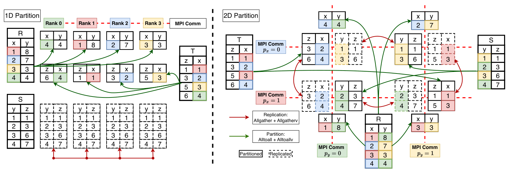

[Read the paper (PDF) — Distributed Datalog at Scale with Worst-Case Optimal Joins](/files/research/distributed-datalog.pdf)

A graph query that looks for triangles can generate a long list of two-edge paths before checking which paths close into triangles. On a cluster, storing and moving those partial matches can dominate the query. Our Datalog engine uses worst-case optimal joins to check constraints one variable at a time. The challenge is getting the relevant facts onto the same process as recursive rules keep producing new ones.

We arranged MPI processes in a multidimensional grid and partitioned each relation by the variables it contains. Each process can then perform its joins locally. After each round, the engine redistributes only the newly derived facts and reuses the same grid for the next round.

## How a triangle lands on one rank

Consider a triangle formed by three edge relations, R(x, y), S(y, z), and T(z, x). On a grid partitioned by x and y, an R edge has enough information to identify its cell immediately. An S edge is copied across the x dimension, and a T edge across the y dimension. A rank can then intersect the candidate z values locally. For a recursive query, the same layout handles each round of newly discovered facts.

<figure>
  
  <figcaption>Figure 3 from the preprint. The two-dimensional layout uses the keys present in each relation to determine which ranks need a copy.</figcaption>
</figure>

## Evaluation

Table II reports how runtime changed as we gave two queries more MPI processes on Polaris. Both use the same two-dimensional partitioning layout throughout.

| Query and input | 32 processes | 512 processes | 2,048 processes |
| --- | ---: | ---: | ---: |
| Same generation, G10 | 78.235 s | 7.834 s | 5.462 s |
| Andersen points-to analysis, large input | 17.519 s | 3.804 s | 3.141 s |

We evaluated graph-mining and program-analysis workloads on Argonne’s Aurora and Polaris supercomputers. The grid shape mattered even for the same query. A two-dimensional grid ran the Orkut triangle query faster when memory allowed. At 32 processes on Polaris, only the three-dimensional grid fit in memory. [October 2026 preprint](https://arxiv.org/abs/2610.12692)
