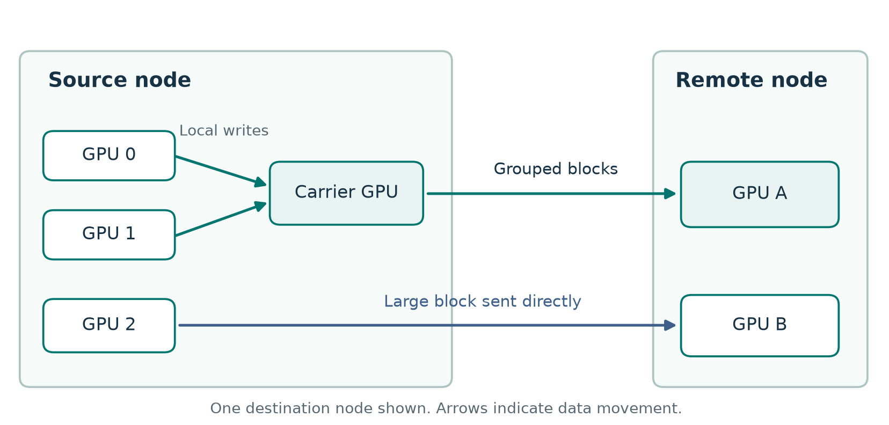
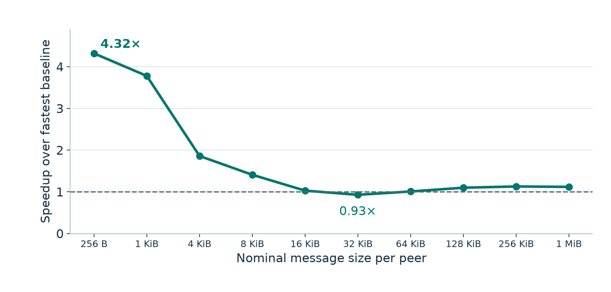
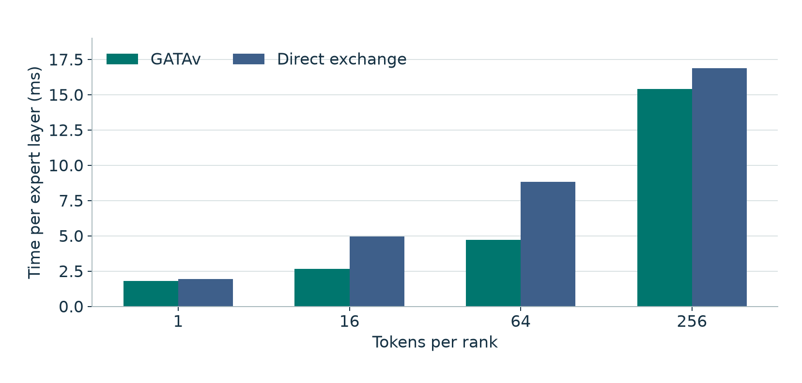
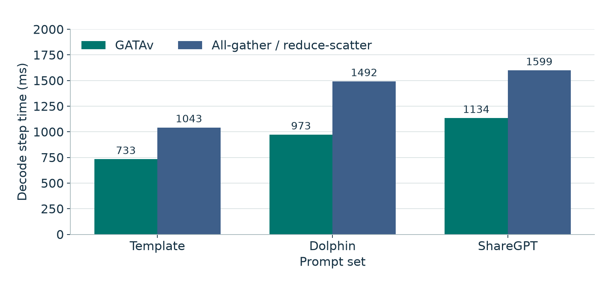

[Download slides (PDF)](/files/research/gatav-slides.pdf) · [PowerPoint slides](/files/research/gatav-slides.pptx)

In a mixture-of-experts model, a router chooses a few experts for each token. When the experts live on different GPUs, the model sends them token activations and returns their outputs to the originating GPUs. The traffic changes with the tokens. Some GPU pairs exchange large blocks while others exchange only a few bytes. GATAv is my implementation of this variable-size all-to-all operation for multi-GPU nodes on the Slingshot network.

## How GATAv moves a block

For small transfers, GPUs on the same node write blocks for the same remote destination into a local carrier GPU’s buffer. The carrier sends the grouped data across the network. This reduces the number of small network messages at the cost of local copies. Large streams can go directly to their destinations, with a bounded number of sends in flight. The sending and receiving processes use the byte counts to determine the layout.

<figure>
  
  <figcaption>The CUDA implementation uses peer access over NVLink on Polaris. The Aurora port uses SYCL and Level Zero for Intel GPUs.</figcaption>
</figure>

## Where aggregation pays off on Polaris

I tested GATAv on up to 512 A100 GPUs. The figure follows one 32-GPU irregular exchange benchmark across message sizes. We warmed up each configuration, synchronized before each timed call, and took the median of the slowest rank’s time over 100 calls. The comparison uses uncompressed data and the fastest default baseline at each size from direct exchange, Cray MPI, NCCL, and UCC.

<figure>
  
  <figcaption>At 256 bytes per peer, GATAv took 39.7 µs and NCCL took 171.6 µs. At 32 KiB, direct exchange took 161.4 µs and GATAv took 174.3 µs. The dashed line marks equal time.</figcaption>
</figure>

## From token exchange to model runtime on Aurora

I first measured three expert layers of DeepSeek-R1 on 12 Aurora nodes (144 GPU tiles). Each timing includes token dispatch, expert computation, and the return exchange. We checked the outputs against oneCCL and ran both timed paths with MPICH’s HMEM option disabled. At 64 tokens per rank, the average layer time fell from 8.83 ms with direct sends and receives to 4.73 ms with GATAv.

<figure>
  
  <figcaption>Timings cover layers 3, 27, and 59. Each layer contributes its median over ten steps, measured at the slowest rank. The advantage was largest among the displayed cases at 16 and 64 tokens per rank.</figcaption>
</figure>

I then integrated GATAv into vLLM and measured full decode steps with DeepSeek-R1. The comparison below uses 32 prompts per rank, fixed expert placement, and the faster of two baseline runs for each prompt set. Prompt choice matters because different tokens route to different experts. Across the template, Dolphin, and ShareGPT inputs at this batch size, GATAv reduced decode-step time by a factor of 1.41–1.53.

<figure>
  
  <figcaption>Full vLLM decode steps on 144 Aurora tiles. On Dolphin prompts, GATAv took 973 ms per step and the all-gather/reduce-scatter path took 1,492 ms. These timings include the rest of the model.</figcaption>
</figure>
