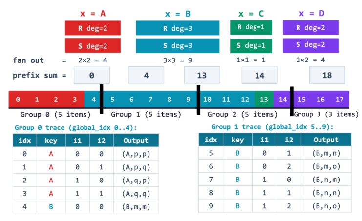

[Read the paper (PDF) — Scaling Worst-Case Optimal Datalog to GPUs](/files/research/gpu-datalog.pdf)

Program-analysis rules often match facts from several relations at once. Evaluating those matches two relations at a time can fill GPU memory with partial results that the final rule discards. In SRDatalog, we use worst-case optimal joins to intersect candidate values one variable at a time.

Making that algorithm effective on a GPU requires balancing the work. A frequent key can leave one group of threads with far more candidates to check than its neighbors. We use a histogram of key frequencies to distribute that work, store relations in flat columns, and size output buffers in two phases. These choices address both uneven execution time and limited device memory.

## Dividing a skewed join across the GPU

Giving each thread group one key can create a long tail when a few keys have many matches. SRDatalog estimates the work per key from its fan-out, computes a prefix sum, and divides that range among groups of GPU threads. Several groups can therefore share a heavy key. The engine stores relations in sorted columns and merges newly derived records into the existing relation between recursive iterations.

<figure>
  
  <figcaption>Figure 2 from the preprint. A group receives a slice of the work range, which can start or end inside a key’s fan-out.</figcaption>
</figure>

## Evaluation

Figure 4 in the paper compares three GPU join workloads. On query Q7, a star-shaped pattern in the LSQB benchmark, SRDatalog completed the join in 2.17 s and cuMatch in 4.50 s. Both systems ran the query in GPU memory.

On the disassembly-analysis benchmark for Z3, SRDatalog processed 126.9 million input facts in 2.00 seconds on one NVIDIA RTX 6000 Ada GPU. The same workload took 24.4 seconds in Ascent on 32 CPU cores. [April 2026 preprint, Table 2](https://arxiv.org/abs/2604.20073)
