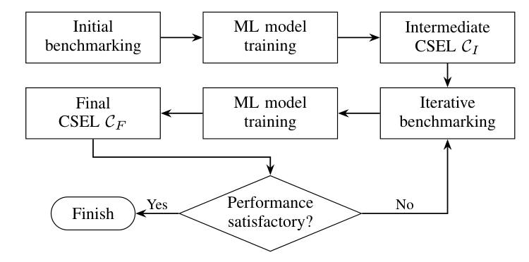

[Read the paper (PDF) — Execution-Path- and Restriction-Aware Autotuning for MPI Collective Operations](/files/research/mpi-broadcast.pdf)

An MPI broadcast sends data from one process to every process in a group. To train an autotuner, we need to know how long each broadcast algorithm takes. That measurement can be misleading in MPICH. If a configuration violates an algorithm’s restrictions, the library can silently run a fallback. If the algorithm calls another collective, its measured time also depends on how that inner call is tuned.

We grouped configurations by which algorithms they support and trained a separate model for each group. We first tuned algorithms that run independently. With that policy in place, we measured the algorithms that make nested calls and used those measurements to train the final broadcast policy.

## How we verified the training data

Forcing an algorithm by name is only the first step. We used counters to check which implementation executed, then fit separate models for the configurations where each candidate was valid. We installed the intermediate policy before timing the hierarchical broadcast, called <code>smp</code>, so its internal broadcasts used known algorithms. We tested the final selector on 252 configurations spanning 32 to 1,024 processes and messages from 32 bytes to 32 MiB.

<figure>
  
  <figcaption>Figure 2 from the ExaMPI paper. The intermediate policy fixes the choices made inside a hierarchical broadcast while the outer algorithm is timed.</figcaption>
</figure>

## Evaluation

Relative to ACCLAiM, the tuner won 207 of 252 cases, giving a geometric-mean speedup of 1.33× and a peak of 2.76×. The largest gain over default MPICH was 30.71× for a 1 MiB broadcast on 1,024 ranks, with 32 ranks per node. At 128 bytes and 64 ranks, with 16 ranks per node, the speedup was 0.80×, so the default was faster in that case. Figures 8 and 9 show the full sweep. [ExaMPI 2026 paper in the SC26 proceedings](https://sc26.supercomputing.org/proceedings/workshops/workshop_pages/ws_exampi107.html)
