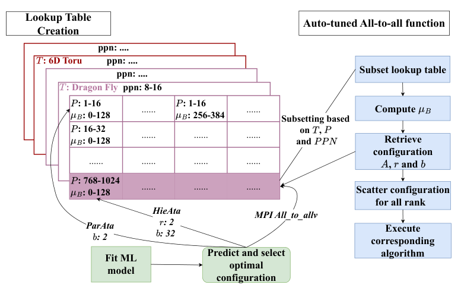
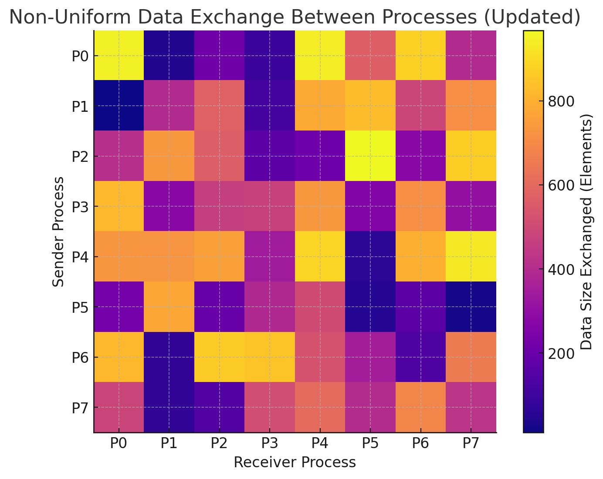

[Read the paper (PDF) — Machine Learning Driven Auto-tuning for Non-uniform All-to-All Collectives](/files/research/mpi-alltoallv.pdf)

In a distributed graph search, a process might discover thousands of new paths in one iteration and just a handful in the next. Each process uses `MPI_Alltoallv` to send those discoveries to the processes that need them. The fastest way to exchange the data depends on how many processes participate and how unevenly the messages are distributed.

We benchmarked the standard collective and two specialized all-to-all algorithms, varying their parameters, the number of processes, and the message sizes. We trained a model to predict communication time and used its predictions to build a lookup table. At each exchange, our C++ implementation uses summary statistics of the messages to select an algorithm and its settings.

## From a performance model to a runtime choice

We fit the model offline using measurements from Polaris and Fugaku. Each lookup-table entry represents a process count, processes per node, network topology, and average message size. Its value records the predicted fastest algorithm and settings, including radix and batch size where applicable. At runtime, the application can query the table again as its communication pattern changes between graph iterations.

<figure>
  
  <figcaption>Figure 3 from the HiPC paper. The left side builds the table from predictions. The right side uses the current exchange to select and dispatch a configuration.</figcaption>
</figure>

## Evaluation

On a 1,024-rank transitive-closure run on Polaris, the tuned exchange took 1.91 seconds, down from 11.52 seconds with the standard collective. The full application ran in 69.49 seconds, down from 79.50 seconds. The measurements appear in Table VI of the paper.

[Presentation slides (PDF)](https://sidharthkumar.io/publications/HiPC_slides.pdf) · [Earlier project poster (PDF)](https://www.evl.uic.edu/documents/kunting.pdf)
